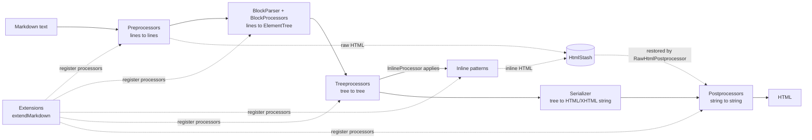

# Python-Markdown: Architecture

Python-Markdown converts Markdown text to HTML. A `Markdown` object runs the text
through a fixed sequence of stages. Each stage is a priority-ordered collection of
small processor objects, and extensions add features by registering more processors
into those collections. The core never needs to know which extensions exist.

## 1. Components

| # | Component | Files | What it does |
|---|---|---|---|
| 1 | **Markdown class / public API** | `markdown/core.py`, `markdown/__init__.py`, `markdown/__main__.py` | Builds the pipeline (`build_parser`), loads extensions, runs `convert()`, owns per-document state (`references`, `htmlStash`) and clears it in `reset()`. `__main__.py` is the `markdown_py` command line, which reads extension configs from a YAML/JSON file. |
| 2 | **Shared utilities** | `markdown/util.py` | `Registry` (the priority-ordered collection used by every stage), `Processor` base class, `HtmlStash` (raw-HTML store), `AtomicString` (text that must not be processed further), placeholder constants, `parseBoolValue`. |
| 3 | **Preprocessors** | `markdown/preprocessors.py`, `markdown/htmlparser.py` | Work on the list of source lines before parsing: normalise whitespace, and pull raw HTML blocks out into the `HtmlStash`, leaving placeholders. |
| 4 | **Block parser** | `markdown/blockparser.py`, `markdown/blockprocessors.py` | `BlockParser` splits text into blocks at blank lines and offers each block to the registered `BlockProcessor`s in priority order. The first whose `test()` accepts the block runs and adds elements (paragraphs, lists, headers, code blocks, quotes) to an ElementTree. If its `run()` returns `False`, the parser offers the block to the next processor. |
| 5 | **Tree processors and inline patterns** | `markdown/treeprocessors.py`, `markdown/inlinepatterns.py` | Tree processors walk and modify the finished ElementTree. The most important one, `InlineProcessor` (priority 20), applies the inline patterns (code spans, escapes, links, images, raw inline HTML, emphasis) to the text of every element. |
| 6 | **Serializers and postprocessors** | `markdown/serializers.py`, `markdown/postprocessors.py` | Serializers turn the tree into an HTML or XHTML string (`output_format`). Postprocessors then work on that string, mainly putting stashed raw HTML back in place of its placeholders. |
| 7 | **Extension API and built-in extensions** | `markdown/extensions/__init__.py`, `markdown/extensions/*.py`, `pyproject.toml` | `Extension` base class with config handling. Each extension's `extendMarkdown(md)` registers its own processors into the registries of components 3-6. 18 built-in extensions (abbr, toc, tables, footnotes, wikilinks, ...). |

**Who calls whom.** `Markdown.__init__` calls `build_parser()`, which asks each stage
module for its default registry (`build_preprocessors`, `build_block_parser`,
`build_inlinepatterns`, `build_treeprocessors`, `build_postprocessors`). It then
loads the requested extensions and calls `extendMarkdown(md)` on each.
`Markdown.convert()` then runs the stages in order:

**Default registries** (name: priority; a higher number runs first):

- Preprocessors: `normalize_whitespace` 30, `html_block` 20
- Block processors: `empty` 100, `indent` 90, `code` 80, `hashheader` 70, `setextheader` 60,
  `hr` 50, `olist` 40, `ulist` 30, `quote` 20, `reference` 15, `paragraph` 10
- Inline patterns: `backtick` 190, `escape` 180, `reference` 170, `link` 160, `image_link` 150,
  `image_reference` 140, `short_reference` 130, `short_image_ref` 125, `autolink` 120,
  `automail` 110, `linebreak` 100, `html` 90, `entity` 80, `em_strong` 60
- Tree processors: `inline` 20, `prettify` 10, `unescape` 0
- Postprocessors: `raw_html` 30, `amp_substitute` 20

Extensions slot in between these. For example `toc` registers a tree processor at 5,
so it runs after inline parsing. `abbr` registers a block processor at 16 and a tree processor at 7.

**How an extension is loaded and configured.** `Markdown(extensions=[...],
extension_configs={...})` accepts `Extension` instances or strings. For a string,
`Markdown.build_extension()` first looks for an installed entry point of that name in
the `markdown.extensions` group. Otherwise it treats the string as a dotted path
(`package.module` or `package.module:ClassName`) and calls the module's
`makeExtension(**configs)`. An extension declares its options in
`self.config = {'name': [default, 'description']}` before calling
`super().__init__(**kwargs)`. `Extension.setConfig()` stores each value, and when the
default is a `bool` (or `None`) it converts strings such as `"false"`, `"no"` and
`"off"` with `util.parseBoolValue`. Processors read options through
`getConfig()`/`getConfigs()`.

**Per-document state.** One `Markdown` instance may convert many documents.
`Markdown.reset()` clears the `HtmlStash` and the link `references`, then calls
`reset()` on every extension that registered itself with `md.registerExtension(self)`.

## 2. Architecture decisions

### ADR-1: Every stage is a priority-ordered `Registry` of processors

- **Status:** Verified. Upstream changelog for 3.0.0: "Homegrown `OrderedDict` has been replaced
  with a purpose-built `Registry`. All processors and patterns now get 'registered' to a Registry."
- **Context:** Extensions need to add, replace or remove behaviour at precise points in each
  stage, without editing the core and without knowing about each other.
- **Decision:** Each stage holds a `util.Registry`. Items are registered with a string name and a
  numeric priority (`register(item, name, priority)`), iterated from highest to lowest priority,
  and removed by name (`deregister`). Registering an existing name replaces that item.
- **Alternatives considered:** the earlier homegrown `OrderedDict` with location strings such as
  `"_begin"` or `"<name"`; a hard-coded pipeline that extensions change by subclassing `Markdown`.
- **Consequences:** Extensions can insert a processor anywhere just by choosing a number, and can
  override a built-in by reusing its name (`sane_lists` replaces `olist` and `ulist`). The cost is
  that order is implicit. A new processor's priority must be chosen relative to its neighbours,
  for example below `backtick`/`escape` so that code spans and escapes are left alone.

### ADR-2: ElementTree is the intermediate document model

- **Status:** Verified. Upstream release notes for 2.0: "The old home-grown NanoDOM has been
  replaced with ElementTree." `serializers.py` notes its code was "Taken from ElementTree 1.3 preview".
- **Context:** Block structure (lists, quotes, nesting) and inline markup are hard to get right
  with string substitutions alone. Extensions need a structured document to inspect and change.
- **Decision:** The block parser builds an `xml.etree.ElementTree` tree under a `
` root.
  Inline parsing and all later structural changes are done on that tree by tree processors.
  Python-Markdown ships its own serializers (`to_html_string`, `to_xhtml_string`) to write it out.
- **Alternatives considered:** pure regex string-to-string conversion (as in the original
  `Markdown.pl`); the project's own DOM (NanoDOM), which it used before 2.0.
- **Consequences:** Extensions create elements (`etree.Element`/`SubElement`) and do not write HTML
  text. The same tree can be written as HTML or XHTML (for example ` ` vs ` `, boolean
  attributes). Text that must stay literal is wrapped in `util.AtomicString` so the inline
  processor skips it.

### ADR-3: Raw HTML is stashed behind placeholders, not parsed into the tree

- **Status:** Inferred, from `util.HtmlStash` ("stashing HTML objects that we extract in the
  beginning and replace with place-holders") and `postprocessors.RawHtmlPostprocessor`. No
  design discussion was found.
- **Context:** Markdown allows raw HTML, which must reach the output unchanged. It would break
  the block and inline parsers if they saw it, and it is often not well-formed XML.
- **Decision:** `HtmlBlockPreprocessor` (blocks) and the `html`/`entity` inline patterns store
  raw HTML in `md.htmlStash` and leave a placeholder string (`util.HTML_PLACEHOLDER`) in the text.
  After serialization, `RawHtmlPostprocessor` replaces each placeholder with the stored HTML.
- **Alternatives considered:** parsing the HTML into ElementTree elements (fails on malformed
  HTML and changes the author's markup); escaping it (Markdown requires it to pass through).
- **Consequences:** Raw HTML is never touched by Markdown processing. Every stage must keep the
  placeholders intact. The stash is per document, so `reset()` must clear it. The same mechanism
  is used by extensions that produce finished HTML (for example `fenced_code`, `md_in_html`).

## 3. Constraints

Rules a change should not break. The file shows where each can be seen.

1. **New extensions subclass `markdown.extensions.Extension`, implement `extendMarkdown(md)`, and
   their module defines `makeExtension(**kwargs)`.** Every built-in extension module does this.
   (`markdown/extensions/__init__.py`, `class Extension`, and the end of each `markdown/extensions/*.py`)
2. **Extensions change behaviour only by registering processors in `md`'s registries**
   (`md.preprocessors`, `md.parser.blockprocessors`, `md.inlinePatterns`, `md.treeprocessors`,
   `md.postprocessors`) with a name and a priority. They do not edit `Markdown.convert()` or the
   default `build_*` functions. (`markdown/core.py`, `convert()`; `markdown/util.py`, `Registry.register`)
3. **Core modules do not import from `markdown.extensions`.** Dependencies point from extensions to
   the core. The only exception is that `core.py` and `__init__.py` import the `Extension` base class.
   (`markdown/core.py:33`; the stage modules import only `util`, `blockparser`, `htmlparser`, `inlinepatterns`)
4. **Every built-in extension has an entry point in `pyproject.toml`** under
   `[project.entry-points.'markdown.extensions']`. That is what lets users load it by short name,
   e.g. `extensions=['toc']`. (`pyproject.toml`; looked up in `markdown/core.py`, `build_extension`)
5. **Per-document state must be cleared on `reset()`.** An extension that keeps state between
   calls registers itself with `md.registerExtension(self)` and defines `reset()`.
   (`markdown/core.py`, `reset()`; e.g. `markdown/extensions/abbr.py`, `toc.py`, `footnotes.py`)
